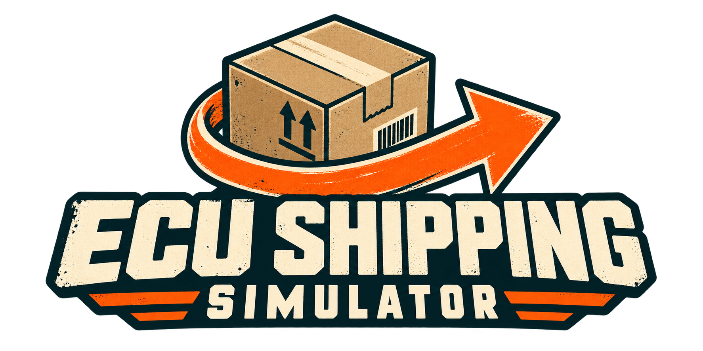

# ECU Shipping Simulator

Una demo de un juego de embalaje y envíos creado por Mateo. Acepta pedidos desde el teléfono, busca el producto en el almacén, embálalo y déjalo en la zona del transportista correcto.

**[Descargar el juego y ver versiones](https://github.com/ecupe/ECUShippingSimulator-Demo/releases)** · **[Reportar un error o dejar una idea](https://github.com/ecupe/ECUShippingSimulator-Demo/issues/new/choose)**

## Cómo jugar

1. Entra en **Releases** y descarga el archivo que termina en **Windows.zip** de la versión que quieras probar.
2. Extrae el ZIP completo.
3. Abre **Windows/ECUShippingSimulator.exe**.

La demo es para **Windows de 64 bits**. No necesitas Unreal Engine ni Visual Studio. Dentro del juego, elige **Jugar** y consulta la ayuda del primer turno.

Si falta Microsoft Visual C++, el instalador incluido está en `Windows/Engine/Extras/Redist/en-us/vc_redist.x64.exe`.

## Controles

| Tecla | Acción |
| --- | --- |
| WASD / ratón | Moverte / mirar |
| Tab | Abrir o guardar el teléfono |
| Enter | Aceptar el pedido con el teléfono abierto |
| E | Recoger o soltar |
| F | Colocar en la mesa y después embalar |
| L | Pegar la etiqueta |
| H | Consultar la ayuda |
| Esc / P | Pausar |
| R | Reiniciar el turno con el teléfono abierto |

## Versiones y actualizaciones

Cada versión tiene su propia publicación en **Releases**, con el número, la fecha de publicación, los cambios y la descarga. Las versiones anteriores siguen disponibles.

La primera build es **pre-alpha 0.1**, del **17 de octubre de 2026**. El [historial de cambios](CHANGELOG.md) describe su contenido.

Para actualizar, descarga la nueva versión y extráela en otra carpeta. La demo no se actualiza sola.

## Cuéntame cómo te fue

En **Issues** puedes elegir **Reportar un error** o **Dejar una sugerencia**. Indica la versión que probaste, qué pasó y, si puedes, cómo repetirlo. Una captura o un vídeo corto ayuda.

Para enviar un reporte necesitas iniciar sesión en GitHub.

## Estado de la demo

Es una pre-alpha para un jugador. Puedes completar pedidos de USPS, UPS y FedEx. La jornada se reinicia al cerrar; las opciones se guardan en tu computadora.

Este repositorio distribuye el juego compilado, el logo y las instrucciones para probarlo. Los archivos de trabajo del proyecto se conservan por separado.

